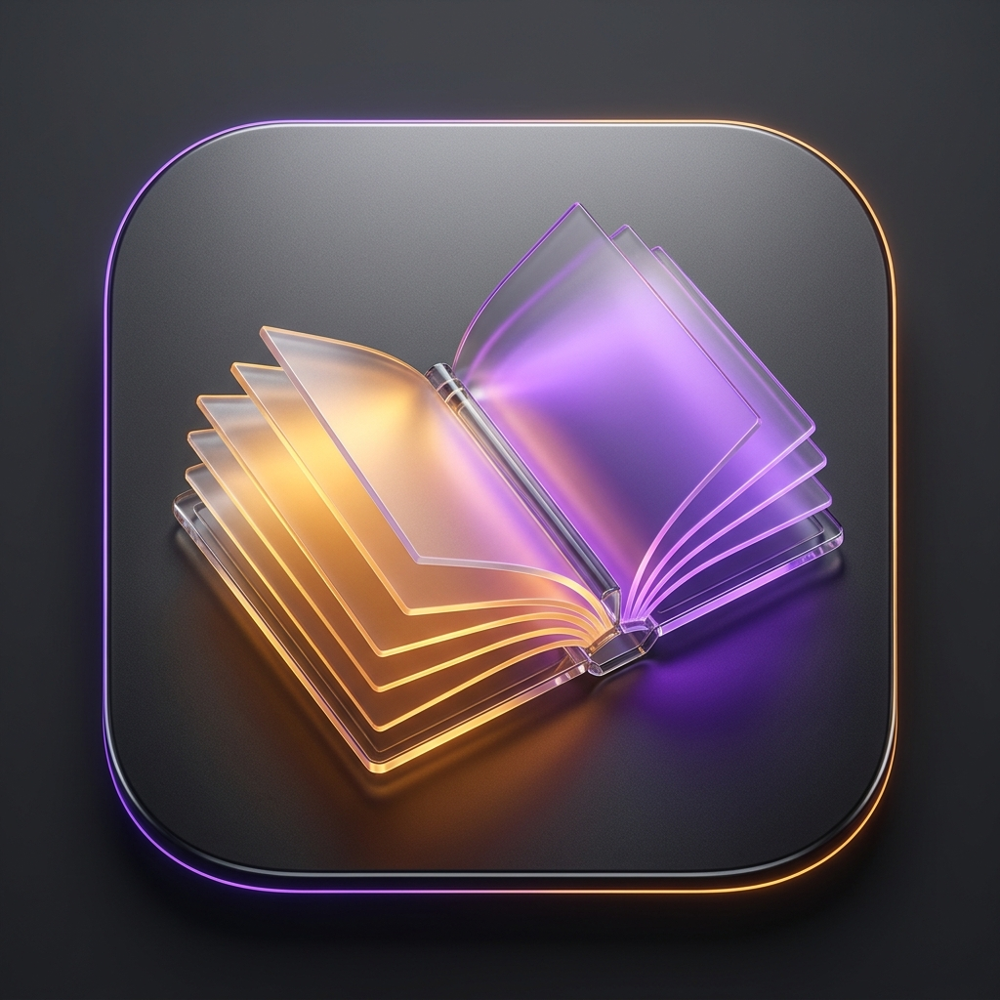
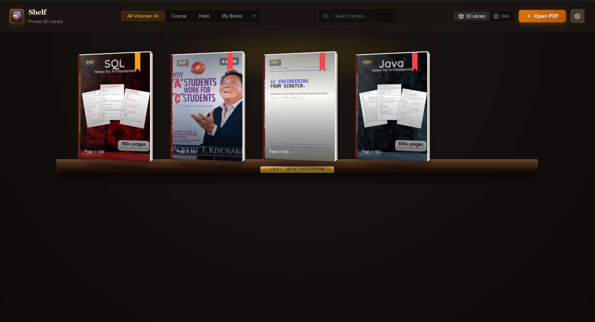
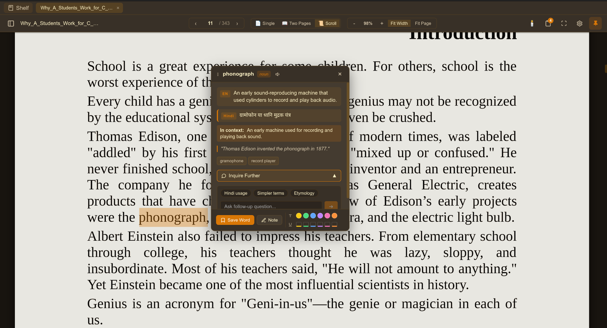

# Shelf — Minimalist AI-Powered PDF Reader 📚⚡

<p align="center">
  
</p>

<p align="center">
  <strong>Distraction-free desktop PDF reading meets real-time contextual AI assistance and persistent vocabulary memory.</strong>
</p>

<p align="center">
  <a href="https://github.com/Bittu-the-coder/PDF-Reader/releases"></a>
  
  
  
  
</p>

---

## 📸 Preview

<p align="center">
  
  <br>
  <em>Figure 1: Interactive 3D Bookshelf Library with custom collections, book covers, and progress bookmarks.</em>
</p>

<br>

<p align="center">
  
  <br>
  <em>Figure 2: Reading view with the floating AI inquiry card, multilingual translation, and 6-color annotation palette.</em>
</p>

---

## 🌟 Why Shelf?

Traditional PDF readers are either bloated with enterprise clutter or completely passive. **Shelf** is engineered from the ground up for deep reading, studying, and technical research:

- 🧠 **Instant AI Word & Passage Inquiry**: Select any word or passage to get instantaneous definitions, contextual grammar analysis, synonyms, or full paragraph explanations in your chosen language.
- 💬 **Multi-Turn Inquire Chat**: Inquire further about any word or concept with AI conversational threads that remember the book's context without ever leaving the page.
- 🖍️ **Seamless Line-Merged Annotations**: Intelligent line-clustering algorithm (`mergeLineRects`) eliminates word wireframe seams and double-track underlines, creating smooth marker fills and single crisp baseline strokes.
- 🌈 **6-Color Vibrant Palettes**: Color-code highlights and underlines with Amber Yellow, Emerald Green, Sky Blue, Amethyst Purple, Rose Pink, and Sunset Orange.
- 🗂️ **Book Memory & Spotlight Pulse**: All your annotations, saved words, and custom notes are stored locally in SQLite. Clicking any note in the drawer jumps directly to the page and spotlights the passage with an animated pulse.
- 📚 **Interactive 3D Bookshelf**: Manage your reading list on an aesthetic wooden bookshelf with cover previews, reading progress bookmarks, and quick collection tabs.
- 🌐 **Model Agnostic**: Bring your own keys — works with Google Gemini (`gemini-2.5-flash`, `gemini-3.5-flash-lite`, custom models) and OpenRouter (`deepseek-r1`, `mistral`, free-tier models).
- ⚡ **Lightweight & Private**: Sub-10MB native Linux binary with offline-first local SQLite storage for all books, positions, notes, and vocabulary.

---

## 🚀 Download & Installation

Visit the [Releases Page](https://github.com/Bittu-the-coder/PDF-Reader/releases/latest) or choose your format below:

### Debian / Ubuntu / Linux Mint / Pop!_OS
```bash
sudo dpkg -i shelf_0.2.0_amd64.deb
```

### Fedora / RHEL / openSUSE
```bash
sudo rpm -i shelf-0.2.0-1.x86_64.rpm
```

### Standalone Linux Binary
```bash
tar -xzf shelf-v0.2.0-linux-x86_64.tar.gz
./shelf
```

---

## 🛠️ Features in Depth

### 1. Contextual AI Inquire Card
- **Draggable & Non-Intrusive**: Move the lookup card anywhere on screen so it never blocks your reading flow.
- **Multilingual Context**: Instant definitions paired with target-language translations (e.g. Hindi, Spanish, French, German).
- **In-Place Chat**: Ask follow-up questions with quick prompt chips (*"Usage examples"*, *"Simpler terms"*, *"Etymology"*) powered by Gemini or OpenRouter.

### 2. Redesigned Annotation Engine
- **Line Clustering**: Groups fragmented client rects from styled text (such as italics and dashes) into unified, seamless bounding boxes per visual line.
- **Single-Track Underlines**: Unified baseline drawing eliminates duplicate parallel underline artifacts.
- **Floating Action Toolbar**: Click any existing highlight or underline to quickly switch colors, toggle between highlight and underline, copy the text, or delete the annotation.
- **Retroactive Rendering**: Automatically clusters and renders all existing annotations stored in your local SQLite database without manual migrations.

### 3. Reading Modes & Themes
- **Flexible Layouts**: Switch seamlessly between **Single Page**, **Two Pages (Dual Spread)**, and **Continuous Vertical Scroll**.
- **Adaptive Themes**: Optimized reading contrast with **Light**, **Sepia**, **Eye Care**, **Dark**, and **Invert** modes.
- **OS Desktop Integration**: Pre-configured `.desktop` entry with `application/pdf` MIME type association for opening files directly or setting Shelf as your default PDF viewer.

---

## ⌨️ Keyboard Shortcuts

| Shortcut | Action |
| :--- | :--- |
| `Ctrl` + `O` | Open new PDF document |
| `Ctrl` + `F` / `F` | Toggle Fullscreen mode |
| `Esc` | Exit Fullscreen / Close active dialogs |
| `Ctrl` + `+` / `Ctrl` + `=` | Zoom In |
| `Ctrl` + `-` | Zoom Out |
| `Ctrl` + `0` | Reset Zoom to 100% |
| `←` / `→` | Previous / Next Page |
| `Ctrl` + `B` | Toggle Book Memory Drawer |

---

## 🏗️ Building from Source

### Prerequisites
- [Rust](https://www.rust-lang.org/tools/install) (1.78+)
- [Node.js](https://nodejs.org/) (v20+ or v24)
- System libraries (Ubuntu/Debian):
  ```bash
  sudo apt install libwebkit2gtk-4.1-dev build-essential curl wget file libssl-dev libgtk-3-dev libayatana-appindicator3-dev librsvg2-dev
  ```

### Development
```bash
# Clone the repository
git clone https://github.com/Bittu-the-coder/PDF-Reader.git
cd PDF-Reader

# Install frontend dependencies
npm install

# Start local Tauri dev server with hot-reload
npm run tauri dev
```

### Production Build
```bash
npm run tauri build
```
Binaries and distribution packages (`.deb`, `.rpm`) are generated in `src-tauri/target/release/bundle/`.

---

## 🧰 Tech Stack

- **Framework**: [Tauri v2](https://v2.tauri.app/) (Desktop bridge)
- **Frontend**: [Svelte 5](https://svelte.dev/) (Runes reactivity, vanilla CSS styling)
- **Backend**: [Rust](https://www.rust-lang.org/)
- **PDF Engine**: [PDF.js](https://mozilla.github.io/pdf.js/) (Custom canvas rendering and text-layer mapping)
- **Database**: [SQLite](https://www.sqlite.org/) via `rusqlite`
- **AI Integrations**: Streaming HTTP client for Google Gemini and OpenRouter

---

## 📄 License

Distributed under the MIT License. See `LICENSE` for more information.

---

<p align="center">
  Crafted with care for readers, researchers, and learners everywhere.
</p>
